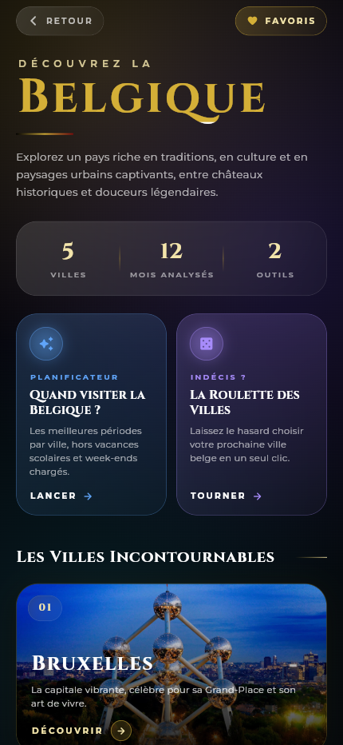
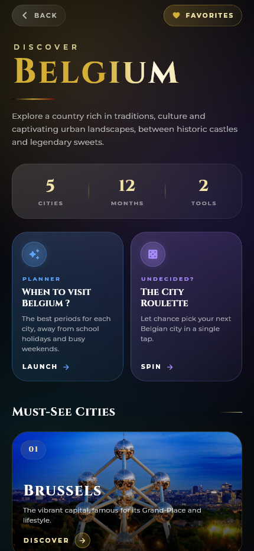
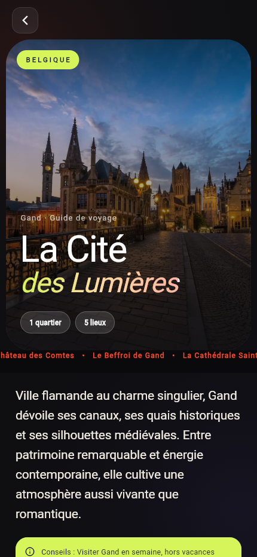
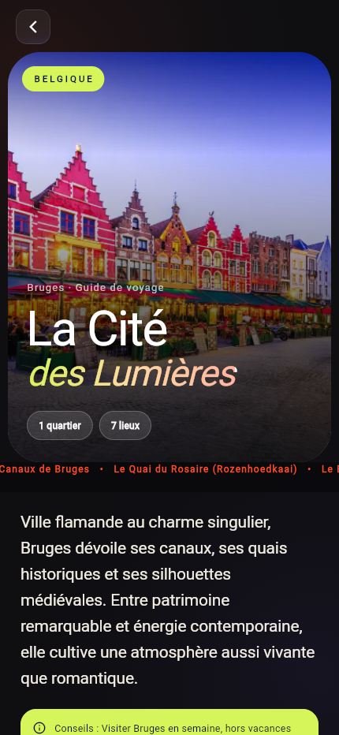
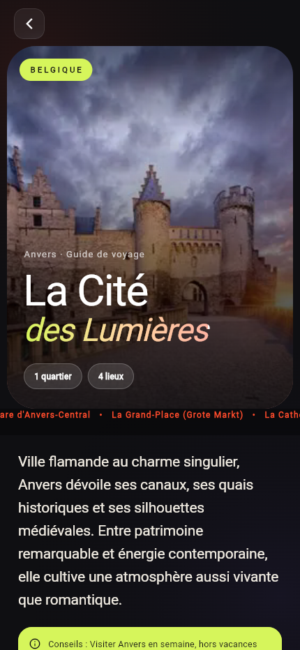

# 🇧🇪 Belgique

<p align="center">
  <strong>DÉCOUVREZ LA BELGIQUE, VILLE APRÈS VILLE.</strong><br>
  Des places historiques aux ruelles médiévales, explorez cinq villes et leurs lieux incontournables.
</p>

<p align="center">
  <a href="https://coco921609.github.io/Belgique/"><strong>Découvrir l’application Web</strong></a>
  &nbsp;·&nbsp;
  <a href="https://github.com/Coco921609/Belgique"><strong>Code source</strong></a>
</p>

<p align="center">
  
  
  
</p>

---

## ✦ L’esprit Belgique

**Belgique** est une application Flutter consacrée à la découverte de cinq villes belges : Bruxelles, Gand, Bruges, Anvers et Liège.

L’écran d’ouverture propose de choisir entre le français et l’anglais. L’application mène ensuite vers une interface immersive qui présente les villes, leurs quartiers et leurs lieux de découverte.

## ✦ Cinq villes à découvrir

| VILLE | UNIVERS |
|:--|:--|
| 🏛️ **Bruxelles** | La capitale, ses quartiers et son patrimoine |
| 🏰 **Gand** | Une ville historique et ses monuments |
| 🚲 **Bruges** | Les canaux, le centre médiéval et les lieux emblématiques |
| 💎 **Anvers** | Le patrimoine, l’architecture et les lieux incontournables |
| 🌿 **Liège** | La Cité ardente, ses quartiers et ses monuments |

## ✦ Le parcours de l’application

<p align="center">
  <strong>8 CAPTURES · FORMAT MOBILE · FRANÇAIS & ENGLISH</strong><br>
  <em>Du choix de la langue aux pages des cinq villes.</em>
</p>

<p align="center"><em>Captures réalisées depuis les écrans Flutter · 430 × 932 px</em></p>

<table>
<tr><td align="center"><strong>01 — Choix de la langue</strong><br><a href="docs/screenshots/01-choix-langue.png"></a></td><td align="center"><strong>02 — Accueil français</strong><br><a href="docs/screenshots/02-accueil-francais.png"></a></td></tr>
<tr><td align="center"><strong>03 — Home English</strong><br><a href="docs/screenshots/03-home-english.png"></a></td><td align="center"><strong>04 — Bruxelles</strong><br><a href="docs/screenshots/04-bruxelles.png"></a></td></tr>
<tr><td align="center"><strong>05 — Gand</strong><br><a href="docs/screenshots/05-gand.png"></a></td><td align="center"><strong>06 — Bruges</strong><br><a href="docs/screenshots/06-bruges.png"></a></td></tr>
<tr><td align="center"><strong>07 — Anvers</strong><br><a href="docs/screenshots/07-anvers.png"></a></td><td align="center"><strong>08 — Liège</strong><br><a href="docs/screenshots/08-liege.png"></a></td></tr>
</table>

<sub>Cliquez sur une image pour consulter la capture originale. Les deux écrans d’accueil montrent les versions française et anglaise.</sub>

## ✦ Fonctionnalités

- Choix de la langue : français ou anglais.
- Accueil présentant cinq villes belges.
- Pages détaillées consacrées à Bruxelles, Gand, Bruges, Anvers et Liège.
- Gestion des favoris.
- Outils de découverte et de sélection aléatoire de ville.
- Navigation dans les quartiers et les lieux présentés.

## ✦ Technologies

| TECHNOLOGIE | UTILISATION |
|:--|:--|
| **Flutter / Dart** | Application multiplateforme |
| **Google Fonts** | Typographie |
| **Shared Preferences** | Préférences et favoris |
| **URL Launcher** | Ouverture de liens externes |
| **GitHub Actions** | Déploiement Web et captures automatisées |
| **Playwright / Chromium** | Captures des écrans Flutter |

## ✦ Mise à jour automatique des captures

Le workflow GitHub Actions utilise `tool/screenshot_harness.dart` pour ouvrir les widgets Flutter dans Chromium et capturer les écrans au format mobile **430 × 932 px**. Il vérifie la présence des huit captures et contrôle qu’elles sont distinctes avant de les enregistrer dans `docs/screenshots/`.

Le workflow se lance sur les mises à jour de la branche `main` ou manuellement depuis l’onglet **Actions**. Les captures montrent le rendu Web mobile de l’application Flutter.

## ✦ Installer le projet

Prérequis : Flutter installé et configuré.

```bash
git clone https://github.com/Coco921609/Belgique.git
cd Belgique
flutter pub get
flutter run
```

Pour générer la version Web :

```bash
flutter build web --release --base-href "/Belgique/"
```

## ✦ Retrouver Belgique

- **Application Web :** [Ouvrir Belgique](https://coco921609.github.io/Belgique/)
- **Dépôt GitHub :** [Coco921609/Belgique](https://github.com/Coco921609/Belgique)
- **Documentation Flutter :** [docs.flutter.dev](https://docs.flutter.dev/)

---

<p align="center">
  <strong>BELGIQUE</strong><br>
  <em>Cinq villes, mille découvertes.</em>
</p>


## ✦ Ouvrir ce projet Flutter dans Android Studio

### 1. Cloner le dépôt et entrer dans le dossier

```bash
git clone https://github.com/Coco921609/Belgique.git
cd Belgique
```

### 2. Vérifier Flutter et installer les dépendances

Exécutez ces commandes à la racine du projet, dans le dossier qui contient `pubspec.yaml` :

```bash
flutter doctor
flutter pub get
```

### 3. Ouvrir le projet dans Android Studio

**Windows (PowerShell), macOS ou Linux** — si la commande `studio` est disponible dans le PATH :

```bash
studio .
```

Sur macOS, vous pouvez aussi utiliser :

```bash
open -a "Android Studio" .
```

Si `studio` n’est pas reconnu, ouvrez Android Studio manuellement, cliquez sur **Open**, puis sélectionnez le dossier `Belgique`.

### 4. Démarrer l’application

Démarrez un émulateur Android ou connectez un téléphone avec le débogage USB activé, puis lancez :

```bash
flutter devices
flutter run
```
